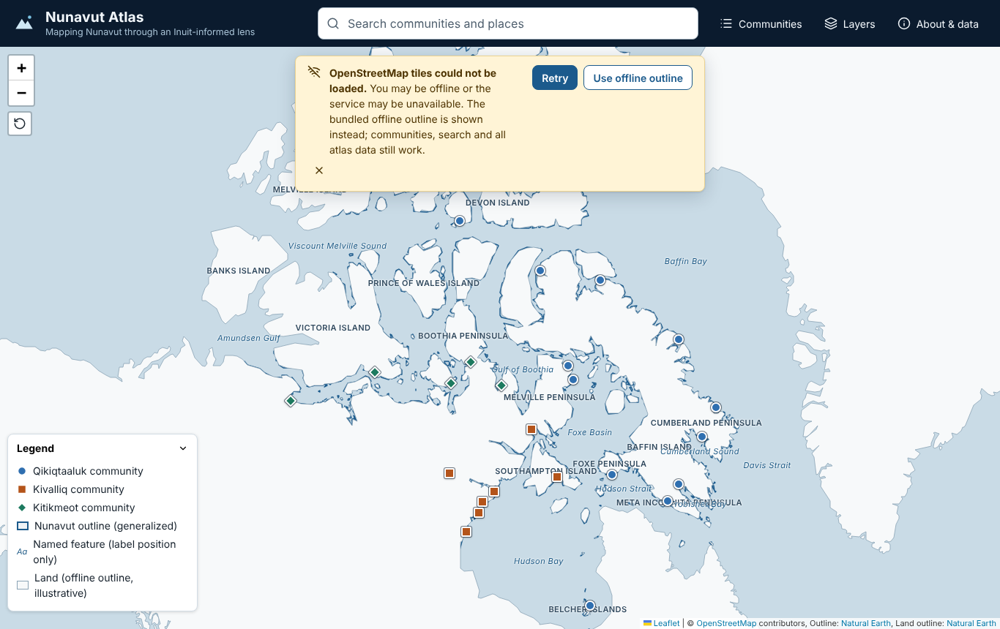
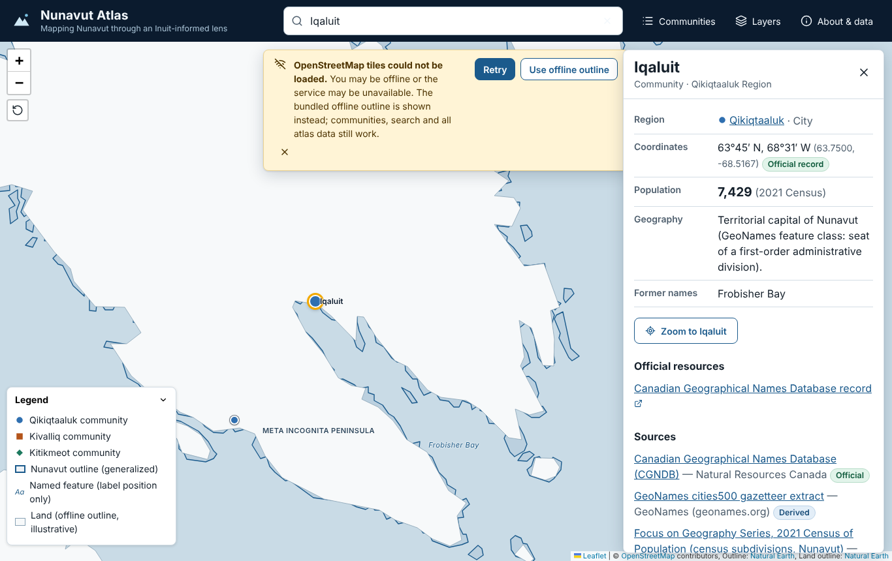
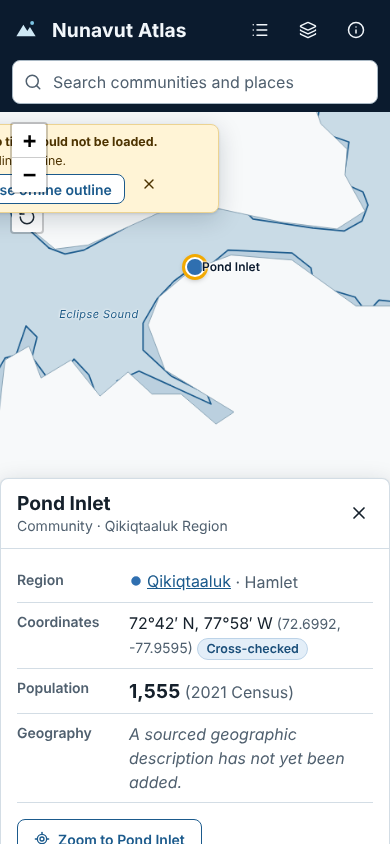

# Nunavut Atlas

**Mapping Nunavut through an Inuit-informed lens.**

Nunavut Atlas is an open-source, browser-based geographic atlas of Nunavut. It brings together the territory's communities, its three regions and its major islands and waters in one accessible map.

The project follows a simple view: the Arctic should be shaped by Inuit knowledge, Inuit priorities, community needs and Inuit ownership, not treated only as a source of resources. In practice the atlas shows where each piece of information comes from and how reliable it is. When something has not been verified, it says so instead of filling the gap.

The atlas is a static web application. It needs no server, database, account or API key, and it can be hosted on GitHub Pages.

---

## Current capabilities

| Feature | Status |
| --- | --- |
| Interactive map framed on Nunavut, with pan, zoom (mouse, touch, keyboard) and a reset-view button | Working |
| All 25 municipalities as markers at sourced coordinates. Region is shown by colour **and** shape (circle, square, diamond). | Working |
| Search across community names, recorded former names (e.g. *Frobisher Bay*, *Cape Dorset*), Inuktut name forms, the three regions and 39 named physical features. Case- and whitespace-insensitive, partial matches, keyboard navigation. | Working |
| Community details panel: Inuktut name forms, region, coordinates with verification level, 2021 census population, description, former names, official links, sources and last-reviewed date. Missing values are explained, never invented. | Working |
| Region views (Qikiqtaaluk, Kivalliq, Kitikmeot) shown as **groups of communities**, with a region filter on the map and list | Working (no boundary polygons; see limitations) |
| Layers panel: available layers with toggles, sources, classification and storage type; planned layers listed as "Data not yet available" | Working |
| Legend for the visible layers | Working |
| Generalized Nunavut outline and island/peninsula/water labels (Natural Earth) | Working |
| Base maps: OpenStreetMap, NASA Blue Marble relief, or a bundled offline outline | Working |
| Offline fallback: if online tiles fail, a banner explains why and the bundled land outline is drawn; all atlas data, search and panels keep working | Working |
| Community list grouped by region, as a text alternative to the map | Working |
| About & data panel with the full source register, data classifications and a privacy note | Working |
| Deep links (`#/community/iqaluit`, `#/region/kivalliq`, `#/feature/ne-baffin-island`) | Working |
| Responsive layout with bottom sheets on phones | Working |
| Region boundaries, airports, waterways, protected areas, weather and research stations, telecom, permafrost, sea ice | **Planned**: shown as unavailable until verified data is added |

## Screenshots

These screenshots come from the browser smoke test (`npm run e2e`). That test blocks online tiles on purpose, so they show the **offline fallback**, not the OpenStreetMap base map.

| Overview (offline outline) | Community details | Mobile |
| --- | --- | --- |
|  |  |  |

To refresh them, run `SCREENSHOT_DIR=screenshots-tmp npm run e2e` and copy the files you want into `docs/screenshots/`.

## Technology

- [React 19](https://react.dev/) + [TypeScript 6](https://www.typescriptlang.org/) + [Vite 8](https://vite.dev/)
- [Leaflet 1.9](https://leafletjs.com/) via [React-Leaflet 5](https://react-leaflet.js.org/)
- [Lucide](https://lucide.dev/) icons
- [Vitest](https://vitest.dev/) + [Testing Library](https://testing-library.com/) (jsdom) for unit, component and integration tests
- [Playwright](https://playwright.dev/) (library only) for an optional browser smoke test
- [mapshaper](https://github.com/mbloch/mapshaper) to generalize the bundled GeoJSON (development only)
- ESLint (typescript-eslint, react-hooks) and plain CSS with design tokens (custom properties). No CSS framework.

Exact versions are pinned in `package.json` and `package-lock.json`.

## Prerequisites

- Node.js **20.19+** or **22.12+** (22 LTS is used in CI)
- npm 10+

## Run locally

```bash
npm install
npm run dev
```

Then open the URL Vite prints (normally <http://localhost:5173/>).

## Commands

| Command | What it does |
| --- | --- |
| `npm run dev` | Start the development server with hot reload |
| `npm run build` | Type-check, then build static files into `dist/` |
| `npm run preview` | Serve the built `dist/` locally (set `BASE_PATH=/nunavut-atlas/` to match a default build) |
| `npm test` | Run all Vitest tests once |
| `npm run test:watch` | Run tests in watch mode |
| `npm run lint` | ESLint |
| `npm run typecheck` | TypeScript, no emit |
| `npm run validate:data` | Validate the bundled datasets, the source register and the layer registry |
| `npm run check` | Lint, type-check, validate data and run tests |
| `npm run build:geodata` | Re-download Natural Earth and regenerate `public/data/*.geojson` (needs internet) |
| `npm run e2e` | Browser smoke test of the main user journey against `dist/` (run `npm run build` first; needs a Chromium. Set `CHROMIUM_PATH` if Playwright's browser is not installed) |

## Production build and base path

```bash
npm run build
```

The output in `dist/` is plain static files. By default, production builds expect to be served from `/nunavut-atlas/`, which is the path of a GitHub Pages project site. To change this, set `BASE_PATH`:

```bash
BASE_PATH=/ npm run build            # site at the domain root (custom domain)
BASE_PATH=/my-fork-name/ npm run build
BASE_PATH=./ npm run build           # fully relative build (works under any path)
```

The setting lives in `vite.config.ts`. The app uses hash-based deep links (`#/community/...`), so a visitor who refreshes a deep link never gets a 404 on static hosting.

## Deploy to GitHub Pages

The workflow in `.github/workflows/ci-pages.yml` runs on every push and pull request. It installs from the lockfile, then runs lint, type-check, data validation and tests, then builds. On pushes to `main` it also publishes `dist/` to GitHub Pages. It uses only the standard `GITHUB_TOKEN` permissions. No secrets are needed.

One-time setup by the repository owner:

1. In the repository on GitHub, open **Settings → Pages**.
2. Under **Build and deployment → Source**, choose **GitHub Actions**.
3. Push to `main`, or run the workflow by hand from the **Actions** tab ("Run workflow").
4. When the **Deploy to GitHub Pages** job finishes, the site is at `https://<owner>.github.io/<repository>/`. The workflow sets `BASE_PATH` from the repository name automatically.

If the deploy job fails with a Pages error, check that step 2 was done. The check-and-build job does not depend on Pages being enabled.

> **Status:** this repository contains the deployment workflow, but as of this release it has **not** been deployed. Nobody has verified a public URL yet.

## Project structure

```
src/
  app/                App.tsx: state, selection and layout
  components/
    community/        Community, region and feature details; community list
    layers/           Layer panel and legend
    layout/           Header
    map/              Leaflet map, basemap, markers, map controller, status banner
    panels/           About & data sources
    search/           Accessible search combobox
    shared/           Panel, badges, source list, region symbol, labels
  config/             basemaps.ts (all tile providers), map.ts (initial view, zoom)
  data/
    communities/      communities.json (records) + index.ts (validated at startup)
    layers/           registry.ts (available and planned layers)
    regions/          regions.ts
    sources/          sources.ts (data source register)
  hooks/              GeoJSON loader, session preferences, hash selection, media queries
  lib/
    geo/              coordinate helpers and GeoJSON validation
    search/           search index and matching
    storage/          sessionStorage wrapper
    validation/       community record validation
  styles/             tokens.css, global.css, map.css
  types/              shared TypeScript types
public/data/          generalized GeoJSON loaded on demand
scripts/              build-geodata.mjs, e2e-smoke.mjs
tests/                Vitest unit, component and integration tests
docs/                 data sources, schema, data classification, screenshots
```

## Geographic data

The data is described in detail in:

- [`docs/DATA_SOURCES.md`](docs/DATA_SOURCES.md): the source register, licences, access dates, methods and known limitations
- [`docs/DATA_SCHEMA.md`](docs/DATA_SCHEMA.md): the community record and GeoJSON layer formats
- [`docs/DATA_CLASSIFICATION.md`](docs/DATA_CLASSIFICATION.md): what *official*, *derived*, *illustrative/schematic* and *incomplete/planned* mean, and how the app shows each

In summary:

- **Communities**: 25 records in `src/data/communities/communities.json`. Every coordinate cites its sources and a verification level. 8 coordinates come from the Canadian Geographical Names Database, 14 are cross-checked between at least two sources, and 3 (Clyde River, Igloolik, Kinngait) rely on a single source. 20 communities have a 2021 Census population from Statistics Canada. The other 5 are left empty on purpose until the figure is confirmed.
- **Nunavut outline, land and physical features**: generalized from [Natural Earth](https://www.naturalearthdata.com/) (public domain) by `scripts/build-geodata.mjs`.
- **Regions**: listed with their Statistics Canada census division codes. **No boundary polygons are drawn.**

## Licensing and attribution

- **Code**: MIT licence (see [`LICENSE`](LICENSE)).
- **Data is not covered by the code licence.** Each dataset keeps its own terms, which are listed in [`docs/DATA_SOURCES.md`](docs/DATA_SOURCES.md) and in the app's *About & data* panel. In brief: Natural Earth is public domain. Statistics Canada data is under the Statistics Canada Open Licence. CGNDB data is under the Open Government Licence – Canada. GeoNames is CC BY 4.0. Wikidata is CC0. Map tiles: © OpenStreetMap contributors (ODbL), and NASA GIBS imagery.
- Attribution for the base map and the Natural Earth layers is shown in the map's attribution control at all times.
- No Inuit artwork, photography or cultural material is included. Adding any would need permission, attribution and context from the people and organizations concerned.

## Privacy

There are no accounts, analytics, advertising or tracking. Search runs entirely in the browser. When an online base map is selected, the visitor's browser requests tiles from that provider (OpenStreetMap or NASA GIBS). The offline outline makes no external requests. Only interface preferences (visible layers, base map) are kept, in `sessionStorage`.

## Known limitations

- **Data was gathered through a restricted network.** Statistics Canada, NRCan and Government of Nunavut websites could not be opened directly from the build environment. Their values were read from search-engine excerpts of the official pages. Each value is recorded with its source, but all of them should be re-checked against the published pages (see `docs/DATA_SOURCES.md`).
- **Five communities have no population yet**: Baker Lake, Gjoa Haven, Kinngait, Naujaat and Sanirajak.
- **Three coordinates are single-source** (Clyde River, Igloolik and Kinngait, all from GeoNames). Natural Earth disagrees with the GeoNames positions for Igloolik (about 13 km) and Kinngait (about 9 km).
- **Inuktut names are sparse and unreviewed.** Only five communities have an Inuktut name form recorded, all from secondary sources and marked "Awaiting language review". The atlas does not yet include Inuit place names beyond the official community names.
- **No region boundaries.** Verified boundary files could not be obtained, so regions appear as groupings, not areas.
- **Generalized outline.** The Nunavut outline is a 1:10 million cartographic generalization. Many small islands are missing and it is not a legal boundary. At high zoom on the offline base map, community points can fall slightly outside the simplified coastline.
- **Web Mercator.** High latitudes look much larger than they are.
- **OpenStreetMap tile policy.** The default OSM tiles suit light use. A high-traffic deployment should move to a provider whose terms fit (edit `src/config/basemaps.ts`).
- **Online tiles were not visually verified.** The build environment could not reach the OpenStreetMap or NASA GIBS tile servers, so only the offline fallback was tested in a browser.

## Roadmap

- Region boundaries from Statistics Canada census division boundary files
- Inuit place-name layer, developed with appropriate community and organizational guidance (e.g. Inuit Heritage Trust place-name work)
- Airports and aerodromes, protected areas, waterways and other infrastructure from authoritative open datasets
- Community profiles with more verified indicators
- CSV/GeoJSON export of the visible data
- Inuktitut and French interface translations

## Contributing

See [`CONTRIBUTING.md`](CONTRIBUTING.md). It covers adding a community record, adding a GeoJSON layer, updating source metadata, validating data, running tests and submitting changes.
